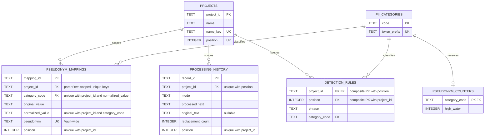

# Initial relational model

Project foreign keys cascade on deletion. A scoped mapping can recur across many documents, but history has no recorded occurrence association with mappings. See [schema](SCHEMA.md) for composite constraints and validation.
